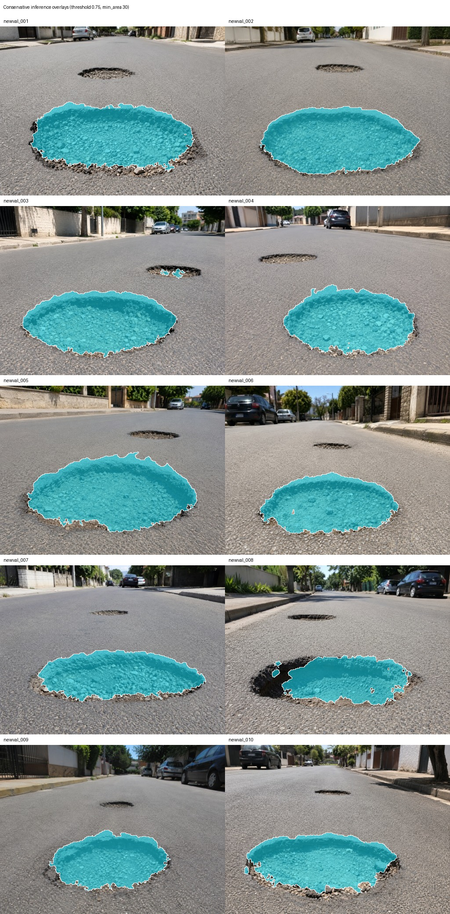

# LiteRaceSegNet

[日本語](README_JA.md) · [한국어](README_KO.md)

A small CNN that segments road damage (potholes) as a binary mask. The full model has about 0.125M parameters. I wanted to see how much of the small damage regions and their edges a model this size can keep.

Result tables and figures: https://jcicaaa3-cloud.github.io/LiteRaceSegNet-FINAL-/



Predicted masks overlaid on the 10 test images.

## Model

Code: `seg/core/lightweight_race.py`

- Stem and inverted-residual blocks in the style of MobileNetV2/V3, written for this project
- A detail branch that keeps high-resolution local cues, and a context branch with a light ASPP module (LiteASPP)
- A boundary head that predicts an edge logit from both branches. The detail features are scaled by `1 + sigmoid(edge)` (boundary gate), and the edge logit is concatenated with the detail and context features before the final fusion (boundary-logit fusion)
- An auxiliary head and loss used during training

## Results

All numbers are from `final_evidence/`. Training ran on an AWS GPU instance, one run per variant, seed 42.

Data: 2,400 training pairs, 10 validation pairs, 10 test images. The dataset, checkpoints, and weights are not in this repository.

### Full model

| Item | Value |
| --- | ---: |
| Validation mIoU (10 images) | 0.8072 |
| Validation damage IoU | 0.7113 |
| Parameters | 0.1245M |
| Latency (CUDA, 256×384 input) | 3.10 ms/image |
| Test damage IoU (10 images) | 0.6623 |
| Test Dice | 0.7951 |
| Test precision / recall | 0.963 / 0.681 |
| Test boundary F1 | 0.058 |
| IoU in 32px and 64px patches along the ground-truth boundary (2,560 patches) | 0.321 |

### Ablation

Validation mIoU with one component removed at a time.

| Variant | mIoU | Δ mIoU | Params (M) | Latency (ms) |
| --- | ---: | ---: | ---: | ---: |
| Full model | 0.8072 | — | 0.1245 | 3.10 |
| No detail branch | 0.7982 | −0.0090 | 0.1245 | 2.67 |
| No boundary gate | 0.8010 | −0.0063 | 0.1245 | 3.05 |
| No boundary-logit fusion | 0.8046 | −0.0026 | 0.1245 | 3.11 |
| LiteASPP replaced by a depthwise-separable conv | 0.7850 | −0.0222 | 0.1235 | 2.76 |
| No auxiliary head/loss | 0.7919 | −0.0153 | 0.1244 | 3.03 |
| Slim backbone | 0.8064 | −0.0008 | 0.0594 | 3.12 |

### Reading these numbers

- The validation set is 10 images and each variant was trained once. Small gaps, such as 0.003 for boundary-logit fusion, should not be read as real effects. The larger drops come from removing LiteASPP and the auxiliary loss.
- The slim backbone has less than half the parameters (0.059M) and almost the same mIoU.
- The model finds the damaged area but loses much of its edge. On the test images precision is 0.96 and recall is 0.68, boundary F1 is 0.058, and recall inside the boundary patches is 0.33.
- The threshold used is 0.60 with a minimum area of 120 px (validation precision 0.918, recall 0.759). A stricter setting of 0.75 and 30 px gives 0.951 and 0.724.

SegFormer-B3 training scripts are included in `seg/transformer_b3/` as a comparison baseline. Its results are not recorded in this repository.

## Run

```bash
pip install -r requirements.txt
python scripts/smoke_check_literace.py                      # builds the model and runs a forward pass
python seg/train_literace.py --config seg/config/pothole_binary_literace_train.yaml
bash scripts/run_v13_ablation_matrix.sh                     # trains the 7 variants and writes the summary
```

Training needs your own image and mask pairs laid out as described in `datasets/pothole_binary/README_DATASET_LAYOUT.md`. The `.bat` files in the root do the same steps on Windows.

## Layout

```text
seg/core/            model, data loading, training utilities
seg/config/          training configs, v13_ablation/ for the 7 variants
seg/tools/           profiling, ablation summary, boundary metrics
scripts/             smoke check, ablation and evidence pipelines
final_evidence/      recorded results: ablation, threshold, test inference, metrics, case split
index.html, pages/   static site
docs/                evaluation protocol, dataset notes (Japanese)
```

## License

Not an open-source license. The code and documents are public for viewing and academic reference only; see [LICENSE](LICENSE). Third-party components keep their own licenses ([THIRD_PARTY_NOTICES.md](THIRD_PARTY_NOTICES.md)).
