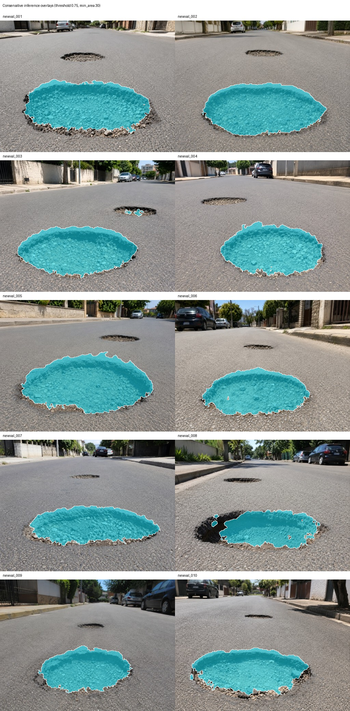

# LiteRaceSegNet

[English](README.md) · [한국어](README_KO.md)

道路の損傷（ポットホール）を二値マスクとして切り出す小さなCNNです。フルモデルのパラメータ数は約0.125Mです。この大きさのモデルで、小さな損傷領域とその縁をどこまで残せるかを確かめたくて作りました。

結果の表と図：https://jcicaaa3-cloud.github.io/LiteRaceSegNet-FINAL-/



テスト画像10枚に予測マスクを重ねたものです。

## モデル

コード：`seg/core/lightweight_race.py`

- MobileNetV2/V3風のステムとinverted residualブロック（このプロジェクト用に実装）
- 高解像度の局所的な手がかりを保つdetailブランチと、軽量なASPP（LiteASPP）を持つcontextブランチ
- 2つのブランチからエッジのロジットを予測する境界ヘッド。detailの特徴を`1 + sigmoid(edge)`でスケールし（boundary gate）、エッジのロジットをdetail・contextの特徴と連結してから最後の融合に渡します（boundary-logit fusion）
- 学習時に使う補助ヘッドと補助損失

## 結果

数値はすべて`final_evidence/`のものです。学習はAWSのGPUインスタンスで、変種ごとに1回、seedは42です。

データ：学習2,400ペア、検証10ペア、テスト10枚。データセット、チェックポイント、重みはこのリポジトリに含めていません。

### フルモデル

| 項目 | 値 |
| --- | ---: |
| 検証 mIoU（10枚） | 0.8072 |
| 検証 損傷IoU | 0.7113 |
| パラメータ数 | 0.1245M |
| レイテンシ（CUDA、入力256×384） | 3.10 ms/枚 |
| テスト 損傷IoU（10枚） | 0.6623 |
| テスト Dice | 0.7951 |
| テスト precision / recall | 0.963 / 0.681 |
| テスト 境界F1 | 0.058 |
| 正解の境界に沿った32px・64pxパッチでのIoU（2,560パッチ） | 0.321 |

### アブレーション

要素を1つずつ外したときの検証mIoUです。

| 変種 | mIoU | Δ mIoU | パラメータ (M) | レイテンシ (ms) |
| --- | ---: | ---: | ---: | ---: |
| フルモデル | 0.8072 | — | 0.1245 | 3.10 |
| detailブランチなし | 0.7982 | −0.0090 | 0.1245 | 2.67 |
| boundary gateなし | 0.8010 | −0.0063 | 0.1245 | 3.05 |
| boundary-logit fusionなし | 0.8046 | −0.0026 | 0.1245 | 3.11 |
| LiteASPPをdepthwise separable convに置換 | 0.7850 | −0.0222 | 0.1235 | 2.76 |
| 補助ヘッド・補助損失なし | 0.7919 | −0.0153 | 0.1244 | 3.03 |
| スリムなバックボーン | 0.8064 | −0.0008 | 0.0594 | 3.12 |

### 数値の読み方

- 検証セットは10枚で、各変種の学習は1回だけです。boundary-logit fusionの0.003のような小さな差は、実際の効果として読むべきではありません。大きく下がるのはLiteASPPと補助損失を外したときです。
- スリムなバックボーンはパラメータが半分以下（0.059M）で、mIoUはほぼ同じです。
- モデルは損傷領域を見つけますが、縁の多くを落とします。テスト画像ではprecisionが0.96、recallが0.68、境界F1が0.058で、境界パッチ内のrecallは0.33です。
- 使ったしきい値は0.60、最小面積120pxです（検証でprecision 0.918、recall 0.759）。より厳しい0.75・30pxでは0.951と0.724になります。

比較用のベースラインとして、SegFormer-B3の学習スクリプトを`seg/transformer_b3/`に入れています。その結果はこのリポジトリには記録していません。

## 実行

```bash
pip install -r requirements.txt
python scripts/smoke_check_literace.py                      # モデルを作って順伝播を1回実行
python seg/train_literace.py --config seg/config/pothole_binary_literace_train.yaml
bash scripts/run_v13_ablation_matrix.sh                     # 7つの変種を学習して要約を出力
```

学習には、`datasets/pothole_binary/README_DATASET_LAYOUT.md`のとおりに配置した自分の画像とマスクのペアが必要です。ルートにある`.bat`ファイルは、同じ手順をWindowsで実行します。

## 構成

```text
seg/core/            モデル、データ読み込み、学習ユーティリティ
seg/config/          学習設定。v13_ablation/に7つの変種
seg/tools/           プロファイル、アブレーションの要約、境界指標
scripts/             スモークチェック、アブレーションと結果生成のパイプライン
final_evidence/      記録した結果：アブレーション、しきい値、テスト推論、指標、ケース分類
index.html, pages/   静的サイト
docs/                評価手順、データセットに関するメモ（日本語）
```

## ライセンス

オープンソースライセンスではありません。コードと文書は閲覧と学術的な参照のためだけに公開しています。[LICENSE](LICENSE)を見てください。第三者のコンポーネントはそれぞれのライセンスに従います（[THIRD_PARTY_NOTICES.md](THIRD_PARTY_NOTICES.md)）。
