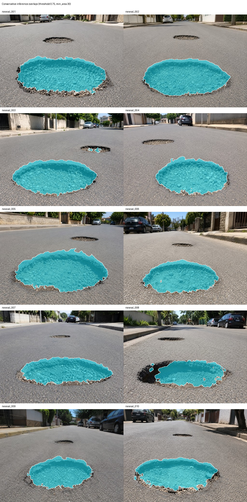

# LiteRaceSegNet

[English](README.md) · [日本語](README_JA.md)

도로 손상(포트홀)을 이진 마스크로 분할하는 작은 CNN입니다. 전체 모델의 파라미터는 약 0.125M입니다. 이 크기의 모델로 작은 손상 영역과 그 가장자리를 어디까지 살릴 수 있는지 보려고 만들었습니다.

결과 표와 그림: https://jcicaaa3-cloud.github.io/LiteRaceSegNet-FINAL-/



테스트 이미지 10장에 예측 마스크를 겹친 것입니다.

## 모델

코드: `seg/core/lightweight_race.py`

- MobileNetV2/V3 방식의 스템과 inverted residual 블록(이 프로젝트용으로 구현)
- 고해상도의 국소 단서를 유지하는 detail 브랜치와, 가벼운 ASPP(LiteASPP)를 둔 context 브랜치
- 두 브랜치에서 에지 로짓을 예측하는 경계 헤드. detail 피처에 `1 + sigmoid(edge)`를 곱하고(boundary gate), 에지 로짓을 detail·context 피처와 이어 붙여 마지막 융합에 넣습니다(boundary-logit fusion)
- 학습 때 쓰는 보조 헤드와 보조 손실

## 결과

숫자는 전부 `final_evidence/`에 있는 값입니다. 학습은 AWS GPU 인스턴스에서 변형마다 한 번씩, seed 42로 돌렸습니다.

데이터: 학습 2,400쌍, 검증 10쌍, 테스트 10장. 데이터셋, 체크포인트, 가중치는 이 레포에 넣지 않았습니다.

### 전체 모델

| 항목 | 값 |
| --- | ---: |
| 검증 mIoU(10장) | 0.8072 |
| 검증 손상 IoU | 0.7113 |
| 파라미터 수 | 0.1245M |
| 지연 시간(CUDA, 입력 256×384) | 3.10 ms/장 |
| 테스트 손상 IoU(10장) | 0.6623 |
| 테스트 Dice | 0.7951 |
| 테스트 precision / recall | 0.963 / 0.681 |
| 테스트 경계 F1 | 0.058 |
| 정답 경계를 따라 자른 32px·64px 패치의 IoU(2,560개) | 0.321 |

### Ablation

구성 요소를 하나씩 뺐을 때의 검증 mIoU입니다.

| 변형 | mIoU | Δ mIoU | 파라미터 (M) | 지연 시간 (ms) |
| --- | ---: | ---: | ---: | ---: |
| 전체 모델 | 0.8072 | — | 0.1245 | 3.10 |
| detail 브랜치 제거 | 0.7982 | −0.0090 | 0.1245 | 2.67 |
| boundary gate 제거 | 0.8010 | −0.0063 | 0.1245 | 3.05 |
| boundary-logit fusion 제거 | 0.8046 | −0.0026 | 0.1245 | 3.11 |
| LiteASPP를 depthwise separable conv로 교체 | 0.7850 | −0.0222 | 0.1235 | 2.76 |
| 보조 헤드·손실 제거 | 0.7919 | −0.0153 | 0.1244 | 3.03 |
| 슬림 백본 | 0.8064 | −0.0008 | 0.0594 | 3.12 |

### 숫자 읽는 법

- 검증 세트가 10장이고 변형마다 학습을 한 번만 했습니다. boundary-logit fusion의 0.003 같은 작은 차이는 실제 효과로 읽으면 안 됩니다. 크게 떨어지는 건 LiteASPP와 보조 손실을 뺐을 때입니다.
- 슬림 백본은 파라미터가 절반 이하(0.059M)인데 mIoU는 거의 같습니다.
- 모델이 손상 영역은 찾지만 가장자리는 많이 놓칩니다. 테스트 이미지에서 precision 0.96, recall 0.68, 경계 F1 0.058이고, 경계 패치 안의 recall은 0.33입니다.
- 사용한 임계값은 0.60, 최소 면적 120px입니다(검증 precision 0.918, recall 0.759). 더 엄격한 0.75·30px에서는 0.951과 0.724입니다.

비교용 베이스라인으로 SegFormer-B3 학습 스크립트를 `seg/transformer_b3/`에 넣어 뒀습니다. 그 결과는 이 레포에 기록돼 있지 않습니다.

## 실행

```bash
pip install -r requirements.txt
python scripts/smoke_check_literace.py                      # 모델을 만들고 순전파 1회 실행
python seg/train_literace.py --config seg/config/pothole_binary_literace_train.yaml
bash scripts/run_v13_ablation_matrix.sh                     # 변형 7개 학습 후 요약 출력
```

학습하려면 `datasets/pothole_binary/README_DATASET_LAYOUT.md`대로 배치한 자기 이미지·마스크 쌍이 필요합니다. 루트의 `.bat` 파일은 같은 과정을 Windows에서 실행합니다.

## 구성

```text
seg/core/            모델, 데이터 로딩, 학습 유틸
seg/config/          학습 설정. v13_ablation/에 변형 7개
seg/tools/           프로파일, ablation 요약, 경계 지표
scripts/             스모크 체크, ablation·결과 생성 파이프라인
final_evidence/      기록한 결과: ablation, 임계값, 테스트 추론, 지표, 케이스 분류
index.html, pages/   정적 사이트
docs/                평가 절차, 데이터셋 메모(일본어)
```

## 라이선스

오픈소스 라이선스가 아닙니다. 코드와 문서는 열람과 학술 참고용으로만 공개합니다. [LICENSE](LICENSE)를 확인하세요. 서드파티 구성 요소는 각자의 라이선스를 따릅니다([THIRD_PARTY_NOTICES.md](THIRD_PARTY_NOTICES.md)).
